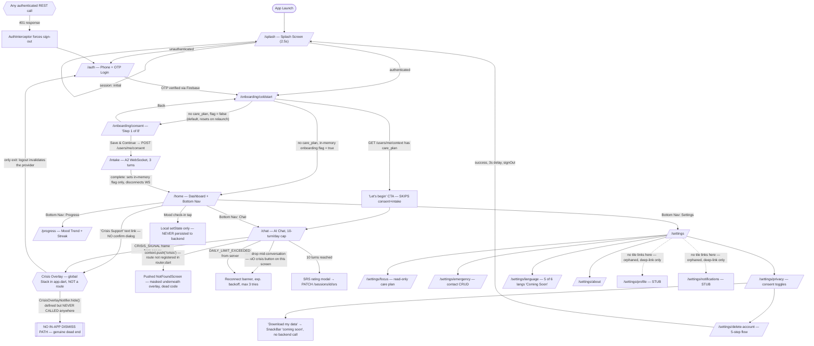

# Evia Mobile — Full Product Audit (Pre-Beta)

**Prepared for:** Evia product/eng team — closed beta readiness review
**Scope:** `apps/mobile` (Flutter client), cross-referenced against `apps/api` (backend orchestrator, WebSocket, Vertex AI/Gemini pipeline) where needed to verify client-observed behavior
**Method:** Static code analysis of the current `develop` branch (HEAD `f68ffe7`, "fix(BUG-11): A2 intake inference pipeline with WebSocket chat + scoring"). **No emulator/device run was performed.** Every finding below is traced to a specific file/line. Anywhere a requested audit dimension inherently requires live/visual verification (touch-target sizing, contrast ratios, animation feel, screen-reader behavior, real performance/battery, tablet/RTL layout), it is explicitly labeled **"code-inferred, not device-verified"** rather than asserted as fact.
**Date:** 2026-07-24

---

## Table of Contents

1. [Executive Summary](#executive-summary)
2. [Product Overview](#product-overview)
3. [Product Flow Diagram](#product-flow-diagram)
4. [Feature Inventory](#feature-inventory)
5. [Screen Inventory](#screen-inventory)
6. [User Journey Maps](#user-journey-maps)
7. [Navigation Audit](#navigation-audit)
8. [UX Findings](#ux-findings)
9. [Mental Wellness Findings](#mental-wellness-findings)
10. [AI Findings](#ai-findings)
11. [Missing States](#missing-states)
12. [Edge Cases](#edge-cases)
13. [Bugs (Functional Audit)](#bugs-functional-audit)
14. [Product Gaps](#product-gaps)
15. [Metrics Recommendation](#metrics-recommendation)
16. [Backlog](#backlog)
17. [Sprint Health](#sprint-health)
18. [Launch Readiness](#launch-readiness)
19. [Top 25 Issues](#top-25-issues)
20. [Top 25 Opportunities](#top-25-opportunities)
21. [Final Recommendation](#final-recommendation)

---

## Executive Summary

Evia's mobile client is a narrow, well-architected shell around a single core loop — **AI chat with a therapist-configured care plan, plus a mood/progress view** — built on solid infrastructure (go_router, Riverpod, Dio with retry/backoff, a real WebSocket protocol, and genuinely strong server-side AI safety routing). The engineering quality of what exists is good: typed state machines, consistent error/loading/empty state patterns on the screens that matter most, and a real safety-classification pipeline on the backend.

However, this is not yet a safe product to put in front of real, vulnerable users in a closed beta, for one overriding reason: **the crisis/emergency support screen has no way to be dismissed.** `CrisisOverlayNotifier.hide()` exists in the code but is never called anywhere in the app. Once shown — which happens on a single, unconfirmed tap of a text link on the Home screen, or automatically when the AI detects risk — a user has no in-app way back to the rest of the product. For a mental-wellness app whose explicit design goal is "never overwhelmed, never judged," a dead-end safety screen is the single most important thing to fix before beta, full stop.

Beyond that headline issue, the audit surfaces a second pattern worth naming: **several features look finished in the UI but are silently disconnected from any backend** — the Home screen's mood check-in never persists anywhere, the Home insight/progress cards render hardcoded placeholder numbers, the Progress screen's care-phase indicator always shows "inactive," and onboarding-completion state resets on every app relaunch for users without an assigned care plan. None of these crash the app; all of them will read to a real user as "I did the thing and it didn't work," which is corrosive to trust in exactly the population this app is trying to support.

Finally, the product surface itself is much smaller than a typical "mental wellness companion" app: there is no journal, no history, no exercises/breathing library, no push notifications, no subscription tier, and no therapist-facing connection beyond a read-only "focus area" label. That's a reasonable and disciplined MVP scope for 4 sprints — the risk is not scope, it's that a few of the features that *are* built don't yet do what their UI implies.

**Bottom line:** Do not ship to real users until the crisis-overlay dead end is fixed. Everything else in this report is real but triageable.

---

## Product Overview

*(Phase 1 — target users, JTBD, value proposition, etc. Some of this is inferred from the stated product brief plus code signals, since strategy documents were not part of the codebase. Assumptions are flagged.)*

- **Target users (inferred from code):** Indian, phone-number-first users already engaged with a human therapist (phone validation regex `^(\+91)?[6-9]\d{9}$`; crisis hotlines are India-specific — iCall, Vandrevala Foundation, NIMHANS, Snehi, 112). The product assumes every user already has, or will be assigned, a therapist and a "care plan" — this is not a stand-alone self-help app, it's a therapist-adjunct tool. **Assumption**, not confirmed by any onboarding copy that states this explicitly to the user, but strongly implied by `cold_start_screen.dart` and `my_focus_area_screen.dart` copy ("Your care plan and focus area are set by your therapist").
- **Job to be Done:** "Help me hold onto what I worked through in therapy, and give me somewhere safe to process feelings between sessions" — consistent with the stated brief ("preserve emotional momentum between therapy sessions").
- **Primary value proposition:** A structured, safety-monitored AI conversation partner available anytime, tuned to a plan the user's real therapist set.
- **Emotional outcome:** Calmer, understood, not alone between sessions. Current implementation partially delivers this (chat quality is server-side strong) but undercuts it with the crisis dead-end and the "did that save?" ambiguity of mood check-in.
- **Core product loop (as built):** Open app → chat with AI (up to 10 turns/day) → rate the session (SRS) → optionally check Progress. **Assumption:** there is no loop back into daily life (no reminders, no journaling, no exercises) — the loop begins and ends inside the Chat screen.
- **Retention loop:** Not really built yet. No push notifications, no streak-driving nudges beyond a passive streak *display*, no re-engagement mechanism at all. Retention today depends entirely on the user remembering to open the app.
- **Activation event (proposed, not instrumented):** Completing the first full A2 intake conversation and receiving a first real chat reply — this is the first moment the product's core value is experienced. **This is not currently tracked as an analytics event** (see [Metrics Recommendation](#metrics-recommendation)).

---

## Product Flow Diagram

**Flows not shown above because they do not exist in the codebase (confirmed absent, not merely undocumented):** deep links, push-notification-triggered navigation, guest mode, premium/subscription upgrade or expiry, change-therapist, account recovery (beyond re-running phone OTP), journal, history browsing.

---

## Feature Inventory

Status legend: **Full** (real, wired to backend), **Partial** (real but with a material gap), **Stub** (UI exists, no function), **Absent** (nothing in the codebase).

| Feature | Purpose | Entry Point | Backend Dependency | Status | Confidence |
|---|---|---|---|---|---|
| Authentication | Phone + OTP sign-in | `/auth` | Firebase Auth + `POST /auth/verify-otp` | **Full** | High |
| Onboarding (Consent) | Capture consent before intake | `/onboarding/consent` | `POST /users/me/consent` | **Full** (mislabeled "Step 1 of 8") | High |
| Assessment/Intake (A2) | 3-turn WebSocket conversation inferring a care plan | `/intake` | WebSocket, real | **Full**, but **its own tests are stale/broken** | High |
| Cold Start routing | Branches returning users around/through onboarding | `/onboarding/coldstart` | `GET /users/me/context` | **Full**, but depends on a **non-persisted** flag | High |
| Mood Tracking (check-in widget) | Daily 1–5 mood tap on Home | `HomeScreen` | **None — no network call at all** | **Stub (UI-only)** | High |
| Journal | — | — | — | **Absent** | High |
| AI Chat | Core conversational support, 10-turn/day cap | `/chat` | WebSocket, Vertex/Gemini via backend orchestrator | **Full** (client-side error surfacing is weak — see AI Findings) | High |
| Voice | Text-to-speech read-aloud of AI replies (no input/dictation) | Chat & Settings toggle | `flutter_tts` + `GET/PATCH /settings/voice` | **Full** (output only) | High |
| Therapist Connection/Booking | — | — | — | **Absent** (only referenced in copy) | High |
| Insights / Mood Trend | 14-day mood chart, streak, care-phase tracker | `/progress` | `GET /progress/mood`, `GET /users/me/context` | **Partial** — chart/streak real; care-phase dots hardcoded inactive | High |
| Settings (hub) | Central settings list | `/settings` | — | **Full** for the 7 tiles shown | High |
| Push Notifications | — | — | — | **Absent** (dependency actively removed, commit `b56a024`) | High |
| Emergency/Crisis Support | Hotline directory, auto/manual trigger | Home text link + `CRISIS_SIGNAL` WS frame | Hardcoded numbers (offline-safe) | **Partial — critical dismiss-path defect** | High |
| Subscription/Premium | — | — | — | **Absent** | High |
| Profile | — | `/settings/profile` (unreachable from UI) | — | **Stub, orphaned** | High |
| History (chat/journal) | — | — | — | **Absent** (chat state is in-memory, wiped on logout) | High |
| Goals | — | — | — | **Absent** | High |
| Exercises (breathing/grounding/CBT) | — | — | — | **Absent** | High |
| Community | — | — | — | **Absent** | High |
| Achievements/Gamification | Streak + milestone bar | Progress screen | `GET /progress/mood` | **Partial** (real streak in Progress; a second, hardcoded placeholder version sits dormant on Home) | High |
| Widgets (OS home-screen) | — | — | — | **Absent** | High |
| Calendar/Reminders | — | — | — | **Absent** | High |
| Data Export | "Download my data" | `/settings/privacy` | **None — "coming soon" placeholder** | **Stub** | High |
| Data Deletion (Account) | Multi-step account delete | `/settings/delete-account` | `POST /account/delete` | **Full** | High |
| Analytics/Telemetry | Usage tracking | App-wide (SDK) | Firebase Analytics + Crashlytics | **Partial/thin** — SDK wired, only SRS-modal events actually logged | High |

---

## Screen Inventory

| Screen | Purpose | Expected User | Key Components/CTAs | Loading | Error | Empty | Missing/Notes |
|---|---|---|---|---|---|---|---|
| Splash | Branded load + session resolve | All | Logo/wordmark animation | N/A (timed) | none | — | Uses placeholder text wordmark, `TODO: replace with official logo asset` |
| Auth (OTP Login) | Phone sign-in | First-time & returning | Phone field, OTP field, resend timer | ✓ (button spinners) | ✓ (invalid phone/OTP messages) | — | Accessibility: no `Semantics` labels found — **code-inferred, not device-verified** |
| Cold Start | Route returning users correctly | Returning, authenticated | "Let's begin" CTA (if care plan exists) | ✓ | falls through silently to resolve-next, no dedicated error UI | — | No error state if `/users/me/context` fails outright |
| Consent | Capture consent before intake | First-time | 4 toggles (1 locked), scroll-gated CTA | — | ✓ (network/4xx/401 handling; dev-mode silently bypasses on error) | — | Mislabeled "Step 1 of 8" — no 8-step flow exists anywhere |
| Intake (A2) | 3-turn assessment chat | First-time | Chat bubbles, progress bar | ✓ | none found | — | No error UI if the WS fails mid-intake — **gap** |
| Home | Daily dashboard | Daily/returning | Mood check-in, insight card, progress summary, Crisis Support link, bottom nav | — | — | Insight card is a static placeholder string, not a true empty state | Mood check-in and progress summary are non-functional / hardcoded (see Feature Inventory) |
| Chat | Core AI conversation | Daily/returning, incl. anxious users | Message list, typing indicator, voice toggle, turn counter, reconnect banner | ✓ | ✓ (reconnect banner) | ✓ ("How are you feeling today?") | No crisis-support affordance built into this screen itself; no bottom nav (back-arrow AppBar only) |
| Progress | Mood trend, streak, care-phase | Returning, reflective use | 14-day line chart, streak card, 5-dot phase tracker | ✓ | ✓ (retry button) | ✓ | Phase tracker always renders all-inactive |
| Settings (hub) | Central settings | All | 7 tiles + voice toggle | — | — | — | No "Profile" or "Notifications" tile despite both screens existing in code |
| Settings → My Focus Area | View therapist-assigned focus | Returning | Read-only badge/text | ✓ | ✓ | ✓ ("No focus area assigned yet") | Read-only — no request/change-therapist action |
| Settings → Emergency Contact | Manage one emergency contact | All | Name/phone form, masked display | ✓ | ✓ (inline) | ✓ (empty form) | — |
| Settings → Privacy & Data | Consent toggles, export, delete link | All | Toggles, Save, Download, links | — | ✓ (inline) | — | Export is a stub SnackBar |
| Settings → Language | Language selection | All | Radio-style list | — | — | — | 5/6 entries permanently disabled, tap handler is unconditionally `null` |
| Settings → About | App info | All | Version text, privacy link | — | — | — | Hardcoded version string, placeholder `FlutterLogo` icon |
| Settings → Privacy Policy | Legal doc | All | In-app webview | — | — | — | Opens external URL via `url_launcher` |
| Settings → Delete Account | Account deletion | All | 5-step confirm flow | ✓ (processing step) | ✓ (409/ACTIVE_SESSION, generic retry) | — | Well built |
| Settings → Profile (orphaned) | — | Nobody (unreachable) | Icon, heading, back button | none | none | none | Stub, dead code |
| Settings → Notifications (orphaned) | — | Nobody (unreachable) | Icon, heading, back button | none | none | none | Stub, dead code |
| Not Found | Fallback for unknown routes | Nobody, intentionally | "Go Home" button | — | — | — | Silently absorbs the broken `/crisis` push |
| Crisis Overlay | Show hotlines | Any user in distress, auto or manual trigger | 5 tap-to-call resource cards | — | — | — | **No dismiss control of any kind** — critical finding |

**Accessibility/visual observations (code-inferred, not device-verified):** no `permission_handler` dependency anywhere and no repo-wide `Semantics(` usage was found during the explore pass, which is a signal (not proof) that custom screen-reader labeling, dynamic-type scaling checks, and touch-target audits have not yet been done as a deliberate pass. A real TalkBack/VoiceOver + large-font-size device pass is needed before beta and is **not something this static audit can certify**.

---

## User Journey Maps

**Note on scope:** Several flows the audit brief asked about do not exist in this codebase at all (guest mode, deep links, notification-triggered flows, premium/subscription expiry, change-therapist, account recovery beyond OTP). These are called out as **Absent** rather than described, per the "do not assume a feature works" instruction.

### 1. First-time user, happy path
Splash → Auth (phone+OTP) → Cold Start (no care plan yet) → Consent → Intake (3-turn WS chat) → Home → Chat → (optional) Progress. **Confirmed in code.**

### 2. Returning user with a therapist-assigned care plan
Splash → Auth → Cold Start detects `care_plan` → "Let's begin" → Chat directly, **skipping Consent and Intake entirely.** **Confirmed in code** (`cold_start_screen.dart`).

### 3. Returning user, no care plan yet, after app restart
Splash → Auth → Cold Start → onboarding-flag check (in-memory, defaults `false` on fresh process) → **routed back into Consent → Intake again**, even if they finished it in a prior session, because completion state is never persisted to disk. **Confirmed defect**, not merely a theoretical edge case — this is the default code path for anyone in this cohort.

### 4. Anxious user triggers crisis support by accident
On Home, a single tap of the "Crisis Support" text link (no confirmation dialog) immediately shows the full-screen hotline overlay. There is then **no way back into the app** short of logging out or force-killing the app. **Confirmed defect.**

### 5. User in an active AI chat receives a crisis signal
Server sends `CRISIS_SIGNAL` mid-conversation → `crisisOverlayProvider` flips true → overlay renders; separately, `chat_screen.dart` also calls `context.push('/crisis')`, which resolves to a broken route and silently stacks a `NotFoundScreen` underneath the overlay. Functionally masked today, but it's live incorrect code that would surface if the overlay mechanism changes.

### 6. AI/WebSocket unavailable mid-conversation
Socket drops → exponential-backoff reconnect (3 tries) → reconnect banner shown → if all retries fail, generic "Connection lost, Retry" state. **The same generic state is shown whether the cause is a real network failure, a server-side pipeline error (`ERROR`/`TURN_FAILED` frame — discarded client-side), or a daily session-limit rejection (`DAILY_LIMIT_EXCEEDED`)** — the user cannot tell these apart, and retrying after a daily-limit rejection will simply fail again with no explanation.

### 7. Voice unavailable
`VoiceToggle` checks TTS language-pack availability and **silently hides itself** if `en-US` isn't installed — a clean graceful degrade, not a bug.

### 8. Expired session / forced logout
Any authenticated REST call receiving a `401` triggers `AuthInterceptor` to sign the user out immediately, invalidating session-scoped providers and routing to `/auth`. **Confirmed, reasonably robust for REST.** The WebSocket path is weaker: on reconnect, the client reuses a **cached token that is never refreshed**, so a socket that drops after the Firebase ID token's ~1-hour expiry will keep failing reconnect attempts with a generic error rather than prompting re-auth. **Confirmed gap, plausible under real timing, not triggered in a live test.**

### 9. Offline mode
Beyond a small cloud-off icon in the Chat app bar (the only consumer of `isOnlineProvider` in the entire app), **there is no offline handling anywhere** — no cached reads, no queued actions, no blocking/gating of network-dependent UI. A user opening the app with no connectivity will see broken or endlessly-loading screens outside of Chat's one indicator.

### 10. Delete account
Home/Settings → Privacy & Data or direct tile → 5-step flow (warning → confirm → processing → success) → real `POST /account/delete` → distinct handling for "already has an active session" (409) and "already deleted" → success screen auto-redirects to Splash after 3s and signs the user out. **Confirmed complete and well-designed** — the strongest flow in the app outside of core chat.

### 11. Guest mode / Change therapist / Account recovery
**Absent.** No guest/anonymous mode exists (auth is required before any screen beyond Splash/Auth). No UI exists to request a different therapist or care plan. No recovery path exists beyond re-running phone+OTP (i.e., losing access to the registered phone number has no documented recovery flow in this client).

---

## Navigation Audit

| Check | Finding |
|---|---|
| Bottom navigation | Exists on Home only (`HomeBottomNav`); Chat/Progress/Settings use back-arrow AppBars instead, so switching "tabs" always round-trips visually through Home. `selectedIndex` is **hardcoded to `0`** (`home_bottom_nav.dart:25`), so the bar never reflects Chat/Progress/Settings as the active tab even while on those screens. |
| Top navigation | Standard back-arrow `AppBar`s on non-Home screens; consistent pattern. |
| Back navigation (Android hardware back) | Multiple screens override the back gesture via `PopScope(canPop: false, ...)` to redirect to a specific route instead of popping (Settings, Progress, all Settings sub-screens, Chat, Account Deletion) — a deliberate, consistent pattern, not a bug, but worth a UX gut-check since it removes standard back behavior in several places. A dedicated `_CrisisAwareBackButtonDispatcher` additionally swallows the hardware back button system-wide whenever the crisis overlay is active. |
| iOS gestures | Not independently verified — **code-inferred only**; `PopScope` handling should also suppress the iOS edge-swipe-back gesture the same way it suppresses Android back, but this needs a device check. |
| Dead ends | **Crisis Overlay** (no dismiss, see above) is a true dead end. |
| Navigation loops | None found. |
| Broken routes | `context.push('/crisis')` in `chat_screen.dart:150` references a route never registered in `router.dart` — resolves to the `errorBuilder`/`NotFoundScreen`. |
| Incorrect redirects | None beyond the onboarding-persistence issue already covered (Journey #3). |
| Pages impossible to reach via normal UI | `/settings/profile` and `/settings/notifications` are both registered and imported but have **no tile linking to them** anywhere — reachable only by manually typing the route. |
| Duplicate pages | None found. |
| Unexpected exits | Crisis overlay's only "exit" is logout — arguably an unexpected/undesirable exit mechanism for a safety screen. |
| Missing confirmations | The Home "Crisis Support" text link has **no confirmation step** before showing a full-screen, non-dismissible overlay — a single mistap has an outsized, currently-irreversible consequence. |

---

## UX Findings

Scores are **code-inferred** (structure, completeness, state coverage, copy tone, friction points) — **not device-verified** for contrast, exact touch-target sizing, or animation feel. 1–10 scale.

| Screen | Score | Rationale |
|---|---|---|
| Splash | 7/10 | Clean, simple; placeholder wordmark asset is a visible rough edge |
| Auth (OTP Login) | 8/10 | Full validation, resend cooldown, clear error states |
| Consent | 6/10 | Functionally solid but "Step 1 of 8" is misleading, undermining trust in a screen about *consent* specifically |
| Intake (A2 chat) | 7/10 | Good conversational pattern; no error state if WS fails mid-assessment |
| Cold Start | 6/10 | Functional but invisible to the user as a "screen" — mostly a router; no error UI if the context fetch fails |
| Home | 4/10 | Multiple visibly "finished" widgets (mood check-in, insight card, progress summary) are non-functional or fake data — highest gap between appearance and reality in the app |
| Chat | 8/10 | The best-built screen: typing indicator, reconnect handling, turn cap communication, SRS follow-up. Loses points for undifferentiated error states and no in-screen crisis affordance |
| Progress | 7/10 | Real chart/streak/empty/error states; loses points for the always-inactive phase tracker |
| Settings hub | 7/10 | Clean list, but 2 of 9 registered sub-screens are dead stubs sitting unused in the codebase |
| Crisis Overlay | **2/10** | Correct content (real hotlines, offline-safe), but the complete absence of a dismiss path makes this the single worst-scoring screen in the product from a UX and safety standpoint |

**Cross-cutting UX observations:**
- **Cognitive load:** generally low — screens are single-purpose, forms are short. Good fit for an anxious-user audience.
- **Microcopy tone:** warm and non-clinical where it's been written carefully (Progress empty states, Focus Area messaging); undercut by mislabeled/placeholder copy (Consent step count, Home's static insight text) that reads as unfinished rather than intentional.
- **Consistency:** loading/error/empty state patterns are consistent across the well-built screens (Chat, Progress, Emergency Contact, Focus Area) — this is good engineering discipline that should be extended to the screens currently missing it (Intake, Cold Start).

---

## Mental Wellness Findings

This is the most important section of the audit given the product's stated purpose.

**What's working well:**
- Crisis hotline content (iCall, Vandrevala Foundation, NIMHANS, Snehi, 112) is hardcoded client-side, so it renders even fully offline — confirmed by a dedicated integration test (`e2e_crisis_offline_test.dart`) that enables airplane mode and asserts the content still appears. This is the right design choice for a safety feature.
- The backend has genuine safety architecture, not just a system prompt: a dedicated safety-classification agent, a governance agent, and a routing layer that can force a `crisis` classification server-side, with the most severe safety states explicitly never routed to the general conversational agent (`apps/api/src/prompts/a2-mvp-v1.0.txt`, `apps/api/src/pipeline/orchestrator.ts`). The system prompt explicitly instructs the model never to claim to be a therapist or crisis line — good boundary-setting, consistent with "not a therapy replacement."
- Chat pacing (10-turn/day cap, SRS check-in after each session) reflects a deliberate, session-like structure rather than an open-ended, potentially compulsive chat loop — a reasonable trauma-informed design choice.

**What's not working, in order of severity:**
1. **The crisis overlay is a dead end.** No close button, `PopScope(canPop: false)`, and `hide()` is never invoked. For a user who taps "Crisis Support" out of curiosity, by accident, or in a moment that has already passed, being trapped on a screen of hotline numbers with no way back is the opposite of "safe" and "never overwhelmed." This is not a cosmetic bug — it actively contradicts the product's stated design principles.
2. **No confirmation before triggering an irreversible, high-intensity screen.** A single unconfirmed tap is all it takes.
3. **No crisis affordance inside the Chat screen itself.** If the connection drops at the moment a message would have triggered a crisis classification, the user's only manual fallback is a text link back on the Home screen — requiring them to notice a "connection lost" banner, back out through an "End session?" confirmation, and navigate away, at precisely the moment they may be least able to do that.
4. **Ambiguous failure states read as rejection.** A daily session-limit rejection and a genuine AI pipeline failure both surface as an identical "Connection lost, Retry" banner. For a user reaching out for support, being told (in effect) "the app is broken" when the real reason is "you've used your sessions for today" is a meaningfully different — and more distressing — experience than the honest message would be.
5. **Trust erosion from non-functional UI.** The mood check-in widget lets a user tap how they feel, shows a canned response, and then discards it — nothing is saved. A user who later checks Progress and sees no reflection of that check-in has no way to know whether the app is broken, whether they did something wrong, or whether it simply doesn't work — any of which undermines the "you are understood" promise.

**Overall tone assessment (code-inferred from copy, not a live emotional read):** Warm and human where deliberately designed (empty states, Focus Area copy), but the product currently reads as **inconsistent** rather than uniformly calm — a user moving from a well-crafted Chat session into a dead-end Crisis screen, or from a caring "how are you feeling" prompt into a check-in that vanishes, experiences a whiplash between "this app understands me" and "this app is not finished," which is a worse outcome for this specific audience than either extreme alone.

---

## AI Findings

| Dimension | Rating | Evidence |
|---|---|---|
| Prompt quality / safety guardrails | **Strong** | Dedicated safety/governance agents server-side; explicit boundary instructions in the A2 system prompt; severe safety states routed away from the conversational agent entirely |
| Conversation continuity / memory | Not independently verifiable client-side beyond the 10-turn session window — **not device/backend-verified for cross-session memory** |
| Hallucination risk mitigation | Handled server-side via routing/governance layers; client has no visibility into when a response was AI-generated vs. a canned degraded fallback (no `fallback_used` field surfaced) |
| Latency / loading indicators | Typing indicator present; good UX pattern |
| Retry | Weak — a blunt 20-second client-side timeout before a generic "no response" SnackBar; does not react to the server's own `ERROR`/`TURN_FAILED` frame, which arrives immediately but is discarded (`websocket_service.dart` `debugPrint`-only handling) |
| Streaming | **Absent** — full response per turn only, no token streaming |
| Safety escalation | Real (`CRISIS_SIGNAL` frame → overlay), but let down entirely by the overlay's missing dismiss path (see Mental Wellness Findings) |
| Conversation reset | Session-capped at 10 turns/day, clearly communicated via turn counter and locked input bar after cap |
| Suggested prompts / conversation starters | **Not found** — chat opens to an empty state with a generic prompt, no suggested opening lines |
| Tone consistency | Server-controlled via system prompt — reasonable to assume consistent, not independently auditable from the client |
| Context preservation across reconnect | Reasonable — reconnect resumes the same session id; **but the WS auth token used on reconnect is never refreshed**, so a long-idle reconnect could fail silently with a generic error rather than a clear re-auth prompt |
| Fallback behavior | Backend sends a canned "degraded" response indistinguishably from a real one when the AI pipeline fails softly — invisible by design, but means the product (and PM) has **zero visibility** into how often this happens |
| Offline behavior | Chat has one small offline icon; no queued messages, no offline composition |

**Overall AI experience rating: 6.5/10.** The underlying AI safety/orchestration architecture is genuinely good — better than the client surface currently gives it credit for. The gap is entirely in the last mile: the client doesn't surface the rich signal the server already sends (error reasons, fallback usage, rate-limit reasons), so users experience worse-than-necessary failure modes for a system that actually knows exactly what went wrong.

---

## Missing States

Confirmed by direct code inspection — states either fully absent or present only as a generic catch-all.

| State | Coverage |
|---|---|
| Loading | ✓ Present on nearly every network-backed screen |
| Empty | ✓ Present on Chat, Progress, Focus Area, Home progress summary |
| Partial/degraded content | ✗ Not surfaced — AI fallback responses are indistinguishable from real ones |
| Offline | ✗ One cosmetic icon in Chat only; no app-wide offline state |
| Server error (5xx) | Partial — generic message, no differentiation by cause |
| Rate limit | ✗ `DAILY_LIMIT_EXCEEDED` renders identically to a network failure |
| Token expired (REST) | ✓ 401 → forced logout, reasonably handled |
| Token expired (WebSocket) | ✗ Reconnect reuses a stale cached token; no refresh-and-retry path |
| Network failure | Partial — WS has reconnect/backoff; REST has retry only for 503 |
| No therapist / no care plan | ✓ Handled (Cold Start branches, Focus Area shows "No focus area assigned yet") |
| No history | N/A — no history feature exists to have an empty state |
| No journal | N/A — feature absent entirely |
| No goals | N/A — feature absent entirely |
| No insights (first-time Progress) | ✓ `_EmptyProgressState` present |
| Permission denied (mic/camera) | N/A — app requests neither; no `permission_handler` dependency at all |
| Notification permission denied | N/A — push notifications are entirely unimplemented, no permission is ever requested |
| Subscription missing | N/A — no subscription model exists |
| AI failed | Partial — client has the signal (`ERROR`/`TURN_FAILED`) but discards it, showing only a generic timeout message |
| Voice failed | ✓ Gracefully hides the toggle if TTS language pack unavailable |
| Missing API / missing internet | Partial — see Offline row above |
| Missing authentication | ✓ Router redirect to `/auth` when session is unauthenticated |

---

## Edge Cases

| Scenario | Observed Behavior (code-level) |
|---|---|
| Double-tapping "Crisis Support" | No debounce found on the button; likely re-invokes `.show()` harmlessly (idempotent state flip) — **not device-verified** |
| Rapid navigation between tabs | No debounce on bottom-nav taps; `context.go()` calls are cheap, unlikely to cause issues, but not device-tested |
| Backgrounding app mid-chat | WebSocket lifecycle tied to the screen's widget lifecycle; **no explicit app-lifecycle (`AppLifecycleState`) handling found** in `chat_screen.dart` — behavior on backgrounding/foregrounding is **not verified**, a real risk area for a persistent WebSocket connection |
| Rotation / tablet layouts | No responsive/adaptive layout logic found (no `LayoutBuilder`/breakpoint handling in screens reviewed) — **code-inferred risk, not device-verified** |
| Very long text / emoji input | No message-length limit or emoji-handling logic found in the chat input — likely renders fine given standard Flutter text widgets, but **not device-verified** |
| Large font sizes / accessibility text scaling | No `MediaQuery.textScaler` overrides or clamps found — app likely respects system font scaling by default (reasonable), but layouts have not been checked for overflow at max scale — **not device-verified** |
| No internet / 2G internet | See Offline Handling above — essentially unhandled outside Chat's single icon and WS reconnect logic |
| App killed and relaunched | Chat history is in-memory only and will be lost; onboarding-completion flag resets (confirmed defect, see Journey #3) |
| Returning after days | No re-engagement mechanic exists (no push notifications); user must remember to reopen the app |
| Expired token mid-session | REST: forced logout (handled). WebSocket: stale-token reconnect failure (gap, see AI Findings) |
| Phone call / interruption during AI conversation | No explicit interruption handling found; standard OS behavior (app backgrounds) would apply, WS lifecycle risk as noted above — **not device-verified** |
| Push notification while chatting | N/A — push notifications do not exist |
| Multiple chat sessions / concurrent tabs | Single WebSocket instance via Riverpod provider; no multi-session UI exists, consistent with the single-session-per-day design |
| Deleting account while a chat is active | `AccountDeletionScreen` explicitly handles a 409 `ACTIVE_SESSION` response with a dedicated error step — **confirmed handled** |

---

## Bugs (Functional Audit)

Concrete, code-confirmed defects (not stylistic opinions):

1. **Crisis overlay has no dismiss path** — `CrisisOverlayNotifier.hide()` (`core/providers.dart:31`) is never called anywhere in the codebase.
2. **`/crisis` route pushed but never registered** — `chat_screen.dart:150` vs. `router.dart` (no matching `GoRoute`); resolves to `NotFoundScreen`.
3. **Mood check-in makes no network call** — `mood_check_in.dart` has no `dio`/network import; selection is local-only and discarded.
4. **Onboarding-completion flag is not persisted** — `onboarding_provider.dart`'s `Notifier<bool>` is in-memory only, defaults to `false` on every process restart.
5. **Stale/broken automated tests for the most recently shipped feature** — `test/features/intake/intake_screen_test.dart` and `integration_test/e2e_onboarding_test.dart` assert against a static dropdown UI (`"Anxiety support"`, `"Low mood support"`, `ValueKey('care_plan_0')`) that commit `f68ffe7` deleted from `lib/` entirely. These tests would fail if run today.
6. **Bottom nav never reflects the active tab** — `selectedIndex` hardcoded to `0` in `home_bottom_nav.dart:25`.
7. **Care-phase tracker always renders inactive** — `const isActive = false;` hardcoded inside a `List.generate` loop, `progress_screen.dart:257`.
8. **Home insight/progress-summary widgets show hardcoded placeholder data** behind a `showData: false` flag and `TODO(E8-S01)` markers — currently dead code, but a landmine if `showData` flips to `true` before the backend wiring lands.
9. **WebSocket reconnect reuses a stale auth token** — never re-fetched from Firebase on `_startReconnect()` (`websocket_service.dart:289-293`).
10. **Server error reasons are silently discarded** — the `ERROR` WS frame only triggers a debug-only `print`, never reaching UI state (`websocket_service.dart:155-159`).
11. **`DAILY_LIMIT_EXCEEDED` is indistinguishable from a network failure** in the UI.
12. **Two fully-built, orphaned settings screens** (`/settings/profile`, `/settings/notifications`) are registered and imported but linked from no menu anywhere.
13. **Data export is a non-functional placeholder** — `privacy_data_screen.dart:108-115` shows a SnackBar with no backend call.
14. **Language screen tap handler is dead code either way** — `onTap: language.isActive ? null : null` (`language_screen.dart:121`) — evaluates to `null` regardless of branch.
15. **Dormant mock-response injection path shipped in production code** — `const bool _useMockResponses = false;` plus a live `injectMockAgentTurn` method in `chat_screen.dart`.
16. **Beta and prod environments point to the same backend URL** (`environment.dart`) — no environment isolation between beta testers and production.
17. **Consent screen's step counter is inaccurate** — "Step 1 of 8" with no corresponding 8-step flow anywhere in the app (`consent_screen.dart:314`).
18. **Hardcoded app version string** in both `settings_screen.dart` and `about_screen.dart` ("Version 1.0.0") rather than reading from `package_info_plus`.
19. **Play Integrity SDK added at the Gradle level with no corresponding Dart/platform-channel usage** (`android/app/build.gradle:115`) — infra scaffolding not yet wired to any app logic.

---

## Product Gaps

Prioritized by expected user impact for a mental-wellness companion, independent of the bug list above.

| Gap | Priority | Suggested Solution / Approach |
|---|---|---|
| Journal | Critical | New feature: a simple, optionally-prompted free-text entry screen with local-first drafting (so nothing is lost before save), stored server-side alongside existing session data; start with write + read-back, defer search/tagging to a later pass |
| Push notifications (foundational — blocks re-engagement, reminders, therapy-prep nudges) | Critical | Re-add `firebase_messaging` (removed in commit `b56a024`), request notification permission at a sensible moment (not on first launch), register the device token against the user server-side, and start with one or two high-value notification types (session-limit reset, gentle daily check-in reminder) before broadening |
| Fixing mood check-in → Progress data pipeline disconnect | Critical | Covered in [Top 25 Issues #4](#top-25-issues) — persist check-ins via a new endpoint and unify with the Progress chart's data source |
| Real data export (compliance/trust for mental-health data) | High | Covered in [Top 25 Issues #16](#top-25-issues) |
| Reflection streaks with real nudges (currently passive display only) | High | Once push notifications exist, add an opt-in nudge ("You're on a 5-day streak — check in today?") driven by the same streak data `ProgressScreen` already computes |
| Session summaries / "what we talked about" recap | High | Backend: have the A2 orchestrator generate a short, non-clinical summary at `SESSION_CLOSED`; client: surface it in the existing SRS modal flow or a new post-session card, reusing the modal's presentation pattern |
| Therapy-session preparation prompts | High | Backend: if the therapist portal has visibility into upcoming session dates, expose that via `/users/me/context`; client: surface a lightweight "Preparing for your next session" prompt on Home tied to that date |
| Chat/session history browsing | Medium | Requires server-side persistence of session transcripts (may already exist for the therapist portal) plus a new list/detail screen on the client; start read-only before adding delete/export |
| Breathing/grounding/CBT micro-exercises | Medium | Content-driven feature: a small library of scripted exercises (text + optional TTS reuse via the existing `tts_service.dart`) reachable from Home, no AI/backend dependency required for v1 |
| Search (once history/journal exist) | Medium | Client-side substring search is sufficient for v1 given expected data volumes per user; defer server-side/full-text search until volume justifies it |
| Offline journaling / cached reads | Medium | Depends on Journal shipping first; use a local-first write (e.g. `hive`/`sqflite`) with background sync once connectivity returns |
| Real localization (Hindi/Tamil/etc. — currently a disabled stub list) | Medium | Standard Flutter `intl`/ARB-file localization; the language *picker* UI already exists in `language_screen.dart`, so this is primarily a translation and `onTap` re-enablement effort, not new UI |
| Apple Health / Google Fit integration | Low | Use `health` package to pull sleep/activity signals (with explicit user consent) as optional context enriching the AI's understanding — genuinely optional, not core to the JTBD |
| Home-screen OS widgets | Low | `home_widget` package for a simple "how are you feeling" or streak widget — depends on mood check-in persistence (#4) shipping first so the widget has real data to show |
| Calendar/reminder integration | Low | Local scheduled notifications (`flutter_local_notifications`) for daily check-in reminders; therapy-session reminders depend on session-date data becoming available (see prep prompts above) |
| Community features | Low | Out of scope for the current therapist-adjunct model; would need a moderation/safety strategy before any peer-to-peer surface is considered, given the user population |
| Dark mode | Low (not found in theming; not requested by brief but commonly expected) | Standard Flutter `ThemeData`/`ThemeMode` support; low technical risk, mostly a design/QA pass across existing screens |

---

## Metrics Recommendation

- **North Star Metric (proposed):** Weekly active users who complete at least one meaningful interaction (a chat turn or a persisted mood check-in) between therapy sessions — directly reflects the stated JTBD ("preserve emotional momentum").
- **Activation Metric:** Completion of first A2 intake + receipt of first real chat reply.
- **Retention Metric:** Day-7 and Day-30 return rate; sessions sustained across 2+ consecutive weeks.
- **Engagement Metrics:** chat turns per session, sessions per week, SRS ratings submitted, (once fixed) mood check-ins per week.
- **Drop-off Metrics:** onboarding funnel drop-off by step (consent → intake turn 1/2/3), chat abandonment before the 10-turn cap, sessions ending in a crisis signal and whether the user returns afterward.
- **Conversion Metrics:** N/A today — there is no subscription/monetization model in the client at all; flag this as an open product-strategy question, not an engineering gap.
- **Feature adoption:** % of sessions using the voice toggle, % of sessions with an SRS rating submitted, % of users who ever tap the mood check-in (even pre-fix).

**Current instrumentation reality:** Firebase Analytics and Crashlytics are correctly wired at the SDK level, but `AnalyticsService.logEvent` is called from **exactly one place in the entire app** — the SRS modal. There is no screen-view tracking and no funnel instrumentation anywhere else.

**Suggested analytics events to add:** `screen_view` (all screens), `onboarding_step_completed`, `consent_given`, `intake_turn_sent`, `intake_completed`, `chat_session_started`, `chat_turn_sent`, `chat_session_ended{reason}`, `crisis_signal_received`, `crisis_overlay_shown`, `crisis_overlay_dismissed` (once built), `mood_checkin_tapped`, `mood_checkin_persisted` (once built), `settings_changed{field}`, `account_deletion_started/completed`, `error_shown{type}`, `ws_reconnect_attempt/success/fail`.

---

## Backlog

### P0 — Must Fix Before Beta

| Title | Description | Impact | Affected Users | Severity | Suggested Solution | Effort | Dependencies |
|---|---|---|---|---|---|---|---|
| Crisis overlay has no dismiss path | `hide()` is defined but never invoked; `PopScope(canPop:false)` with no close control | User can be trapped on a hotline screen indefinitely | All, especially anxious users / accidental triggers | Critical | Add a clearly-labeled "I'm safe, take me back" / close action that calls `.hide()`, logs the dismissal, and returns to the prior screen | S (1-2 days) | None |
| No confirmation before triggering crisis overlay | Single tap of "Crisis Support" text link immediately shows the irreversible overlay | Accidental trigger with no way back (compounds the above) | All | Critical | Add a lightweight confirm step, or make the trigger safe-by-default once dismiss exists | XS | Depends on dismiss fix above |
| `/crisis` route not registered | Dead navigation code, `NotFoundScreen` silently pushed | Currently masked, but incorrect and fragile | Engineering risk | High | Register the route or remove the `context.push` call in favor of the existing overlay mechanism | XS | None |
| Mood check-in doesn't persist | No backend call anywhere in the widget | Users think their check-in was saved; it's discarded | All daily users | Critical | Wire to a real `POST /mood` (or equivalent) endpoint and unify with the Progress chart's data source | M | Backend endpoint if not already present |
| Onboarding completion not persisted | In-memory flag resets every app relaunch for users without a care plan | Repeats consent+intake unnecessarily, erodes trust | New users pre-care-plan | High | Persist via secure storage or backend flag, checked at Cold Start | S | None |
| Stale/broken intake tests | Tests assert a UI deleted in the same commit that shipped the new intake flow | The newest feature has effectively zero regression coverage | Engineering/QA | High | Rewrite `intake_screen_test.dart` and `e2e_onboarding_test.dart` against the current WebSocket-based intake UI | M | None |
| WebSocket token not refreshed on reconnect | Cached token reused indefinitely on reconnect attempts | Silent chat failure after ~1hr idle + drop | Users with intermittent connectivity | High | Fetch a fresh Firebase ID token on each reconnect attempt | S | None |
| Server error reasons discarded client-side | `ERROR`/`TURN_FAILED` frame only debug-printed | Up to 20s of unexplained "typing," then a generic message, when the app already knew the real cause | All chat users during AI/pipeline failures | High | Surface `errorType`/reason to `ChatState` and branch the UI message accordingly | S | None |
| `DAILY_LIMIT_EXCEEDED` shown as connection failure | Identical "Connection lost, Retry" UI for a policy limit and a real outage | Confusing, potentially distressing at the moment of reaching out | Users who hit the daily cap | High | Add a distinct "You've used today's sessions — come back tomorrow" state | S | Depends on error-reason surfacing above |
| No offline handling beyond one icon | No cached reads, no gating, no queued actions anywhere | Broken/blank screens with no connectivity | Users on poor networks | Medium-High | Add basic connectivity gating + cached last-known state for Progress/Focus Area at minimum | M | None |

### P1 — Must Fix Soon

| Title | Description | Priority rationale | Suggested Solution | Effort |
|---|---|---|---|---|
| Remove or build the two orphaned settings stubs | `/settings/profile`, `/settings/notifications` are dead code paths | Confusing to discover, wastes review/QA time, unclear intent | Delete both routes/files for beta (recommended), or wire real tiles into `settings_screen.dart` and build actual content if scope allows | XS (delete) / M (build) |
| Fix bottom nav active-state | `selectedIndex` hardcoded to 0 | Visible correctness bug on the most-used navigation element | Move to a go_router `ShellRoute` so all four tabs share one nav bar driven by the real current route | M |
| Fix Home insight/progress-summary placeholders | Hardcoded data behind a currently-off flag | Landmine if flipped on before backend wiring lands | Keep `showData: false` until the `E8-S01` backend fields exist, then wire to the same provider `ProgressScreen` uses and delete the placeholder literals | S |
| Fix care-phase tracker | Always renders inactive | Visibly broken-looking element on a core screen | Replace hardcoded `isActive = false` with a real comparison against the current phase from `care_plan_provider.dart` | XS-S |
| Build real data export | Currently a "coming soon" SnackBar | Trust/compliance concern for mental-health data specifically | Backend endpoint compiling consent/mood/session metadata into a downloadable file; wire the existing "Download my data" action to it | M-L |
| Expand analytics instrumentation | Only SRS events exist today | No funnel visibility for a PM going into beta | Add a `NavigatorObserver`-based `screen_view` tracker plus targeted events at onboarding/chat/crisis transitions | S-M |
| Fix Consent's "Step 1 of 8" copy | No 8-step flow exists | Misleading copy on the one screen most about honesty/consent | Replace with accurate step count or drop the step-counter framing entirely | XS |
| Remove dormant mock-response code from Chat | `_useMockResponses` flag + injector left in shipped code | Risk of accidental activation, code-cleanliness/safety | Delete from production code, or gate behind `FlavorConfig.isDev` if still useful for manual QA | XS |
| Separate beta and prod backend environments | Currently identical URLs | Beta testers currently hit the same backend/data as production | Stand up an isolated `beta` deployment/config in `environment.dart` and update deploy scripts | M |

### P2 — Next Sprint

| Title | Suggested Solution | Effort |
|---|---|---|
| Real accessibility pass | Add `Semantics`/`semanticLabel` to icon-only controls app-wide, then verify with Flutter's accessibility scanner plus a real TalkBack/VoiceOver device pass (flagged throughout this audit as code-inferred-only, not yet device-verified) | M |
| Local persistence/cache layer | Add a lightweight `shared_preferences`-backed cache for Progress and Focus Area responses so those screens can render "last known" data offline | M |
| Screen-view and funnel analytics events | Reuse the `NavigatorObserver` built for P1's analytics item; extend with the remaining funnel events listed in [Metrics Recommendation](#metrics-recommendation) | S |
| Dynamic app version display | Add `package_info_plus`; replace hardcoded `'Version 1.0.0'` in `settings_screen.dart` and `about_screen.dart` with the live value via a shared `FutureProvider` | XS |
| Confirm Language screen's "Coming Soon" framing | Product/marketing check: ensure no beta-facing copy promises multi-language support before it's real; if confirmed as intentional roadmap messaging, no code change needed beyond the accessibility fix in Top 25 Issue #21 | XS |

### P3 — Future

Full solution/approach detail for each of these is in the [Product Gaps](#product-gaps) table below and [Top 25 Opportunities](#top-25-opportunities) — journal, breathing/grounding exercises, session summaries, therapy-prep prompts, chat/session history, real localization, Health/Fit integrations, OS widgets, calendar/reminders, community features.

---

## Sprint Health

Across roughly 4 completed sprints, the engineering foundation is solid — routing, state management, and the core chat/WebSocket protocol are built with real discipline (typed frames, backoff logic, consistent state patterns). Product debt and UX debt are concentrated in exactly the places you'd expect from feature work outpacing polish: widgets that look finished but aren't wired up (mood check-in, Home insight card), copy that wasn't updated when a flow changed (Consent's step count, intake's stale tests), and small pieces of infra added ahead of their integration (Play Integrity, the dormant mock-response flag).

The most telling signal of process debt is the **stale test suite for the just-shipped A2 intake feature** — it indicates that acceptance criteria and test updates are not consistently part of the definition of done for a feature change, which is a process gap more than a code gap. Similarly, the beta/prod environment collision suggests environment-separation wasn't part of the release checklist yet.

**Risk level: Medium-High**, driven almost entirely by the crisis-overlay defect — remove that one item and the underlying risk level would be **Medium**, typical for a 4-sprint MVP.

---

## Launch Readiness

**Would I ship this to real users in closed beta today? No.**

**Launch blockers:**
1. Crisis overlay has no dismiss path (Mental Wellness / Trust risk — highest severity in this report).
2. Crisis overlay is triggerable with a single unconfirmed tap (compounds #1).
3. Mood check-in silently discards user input (Trust risk).
4. Onboarding-completion state isn't persisted, causing needless repeat onboarding (UX risk, first-impression risk for a specific user cohort).
5. The most recently shipped feature (A2 intake) has no working automated test coverage (Quality-risk / regression risk heading into a beta where this exact flow is the front door).

**Major risks (not blockers, but should be resolved in the same push):**
- Ambiguous error states (daily limit vs. network failure vs. AI failure) could read as the product failing a user at a vulnerable moment.
- No offline handling at all outside Chat's one icon.
- Beta and prod share a backend — any beta-only issue (load, bad data) risks bleeding into production.

**Legal/compliance note:** Data export is advertised in the UI ("Download my data") but not implemented — for a product handling mental-health data, an advertised-but-missing data-rights feature is worth flagging to legal/compliance before any external beta communication references it.

**AI risk:** Server-side safety architecture is genuinely strong; the risk is entirely on the client's failure to surface what the server already knows (see AI Findings). This is a lower-effort fix than it might appear, since no new safety logic is needed — only better plumbing of existing signals.

---

## Top 25 Issues

*(Ranked by severity; drawn from Bugs, Mental Wellness Findings, and Navigation Audit — no filler added beyond genuinely evidenced findings. Each issue includes a concrete, codebase-grounded solution and effort estimate — XS: hours, S: 1-2 days, M: 3-5 days, L: 1-2 weeks+.)*

**1. Crisis overlay has no dismiss path — `hide()` never called anywhere**
**Solution:** Add a clearly-labeled exit control to `crisis_overlay.dart` — a top-corner close icon and/or a bottom "I'm safe, take me back" button — wired to `ref.read(crisisOverlayProvider.notifier).hide()`. Change the current unconditional `PopScope(canPop: false)` so the close action actually returns the user to the previous screen, and log a `crisis_overlay_dismissed` analytics event so the team can see how often and how quickly people leave the screen. Add a widget test asserting the close control calls `.hide()` (mirrors the existing `crisis_overlay_test.dart` structure).
**Effort:** S.

**2. Crisis overlay triggerable via a single unconfirmed tap**
**Solution:** Wrap the Home screen's "Crisis Support" `onTap` (`home_screen.dart:67-73`) in a lightweight `showDialog` confirmation ("Show crisis support resources now?") before calling `.show()`. Leave the automatic server-triggered path (`CRISIS_SIGNAL`) unconfirmed, since that's a genuine safety escalation rather than a casual tap — only gate the manual entry point.
**Effort:** XS (depends on #1 shipping first, so a confirmed trigger still isn't a dead end).

**3. No crisis-support affordance inside the Chat screen itself**
**Solution:** Add a persistent, low-key "Get Support Now" action to `ChatScreen`'s `AppBar` — visible regardless of WebSocket connection state — calling `crisisOverlayProvider.notifier.show()` directly client-side, independent of any server frame, so it still works mid-disconnect.
**Effort:** XS-S.

**4. Mood check-in never persists to any backend**
**Solution:** Add a real network call in `mood_check_in.dart`'s tap handler via a new `MoodCheckInNotifier` following the same Dio + Riverpod pattern already used by `ConsentNotifier`/`EmergencyContactNotifier` (loading/error state, `dioClientProvider`). Confirm or add a `POST /mood` backend endpoint, then invalidate `moodProgressProvider` on success so the Progress chart reflects the check-in immediately — this also closes the "mood check-in doesn't feed the trend chart" disconnect noted in the Feature Inventory.
**Effort:** M (client change is small; depends on backend endpoint availability).

**5. Onboarding-completion flag not persisted to disk**
**Solution:** Replace `onboarding_provider.dart`'s in-memory `Notifier<bool>` with a persisted value — either `shared_preferences` locally, or (preferably) treat it as server-truth by checking `/users/me/context` at `ColdStartScreen` init, since that endpoint is already fetched there for the care-plan check. Read the persisted/server value before deciding routing so a relaunch can't lose it.
**Effort:** S.

**6. Stale/broken automated tests for the just-shipped A2 intake feature**
**Solution:** Rewrite `test/features/intake/intake_screen_test.dart` and `integration_test/e2e_onboarding_test.dart` against the current WebSocket-driven `IntakeScreen`/`IntakeNotifier`, using a fake/mock `WebSocketService` to simulate `AGENT_TURN`/`USER_TURN` frames — `chat_screen_test.dart` already does this for Chat and can be used as the template. Add "tests updated for any flow-replacing PR" as an explicit Definition-of-Done checklist item to prevent recurrence.
**Effort:** M.

**7. `DAILY_LIMIT_EXCEEDED` indistinguishable from a network failure in the UI**
**Solution:** Shares its fix with #8 below — once the server's real error reason is surfaced to `ChatState`, branch on it in `reconnect_banner.dart` to show a distinct, non-retryable message ("You've used today's sessions — come back tomorrow") instead of routing it through the generic "Connection lost / Retry" banner.
**Effort:** S (bundled with #8).

**8. Server `ERROR`/`TURN_FAILED` frame reasons discarded client-side (silent for up to 20s)**
**Solution:** In `websocket_service.dart`'s `_onMessage`, replace the debug-only `print` in the `'ERROR'` case with a real state update — push `reason`/`errorType` into `ChatState` (the `errorTypeStream` already exists but nothing consumes it) and have `chat_screen.dart` map each reason to specific, honest copy instead of the one-size-fits-all reconnect banner. This single change fixes #7 and #16-style ambiguity together.
**Effort:** S-M.

**9. WebSocket auth token never refreshed on reconnect**
**Solution:** In `_startReconnect()` (`websocket_service.dart:289-293`), call Firebase's force-refresh token fetch (`user.getIdToken(true)`) before each reconnect attempt instead of reusing the cached `_token`.
**Effort:** XS.

**10. No offline handling beyond one cosmetic icon in Chat**
**Solution:** Promote `isOnlineProvider` from a single Chat-screen icon to an app-wide, dismissible "You're offline" banner (rendered via the same global `Stack` pattern `app.dart` already uses for the crisis overlay). For Progress and Focus Area, cache the last successful response (e.g., a simple `shared_preferences` JSON cache) and render it with a "last updated X ago — offline" note when a live fetch fails due to connectivity.
**Effort:** M.

**11. `/crisis` route referenced but never registered (dead/broken navigation)**
**Solution:** Delete the dead `context.push('/crisis')` call in `chat_screen.dart:150` — the `CRISIS_SIGNAL` listener in `providers.dart` already triggers the overlay via `.show()`, so the route push is redundant as well as broken. If a routed (rather than Stack-overlay) presentation is ever preferred, register a real `GoRoute('/crisis', ...)` instead — but deleting the redundant call is the smaller, safer fix today.
**Effort:** XS.

**12. Two fully-built settings screens (Profile, Notifications) orphaned and unreachable**
**Solution:** Product call needed: either wire real tiles into `settings_screen.dart` pointing at both routes and build out actual content (profile editing; notification preferences once push notifications exist — see #10 in Opportunities), or delete both screens/routes now to remove dead code and avoid confusing future contributors, revisiting later alongside the push-notification build-out.
**Effort:** XS (delete) or M (build out) — recommend delete for beta.

**13. Bottom nav `selectedIndex` hardcoded, never reflects the active tab**
**Solution:** Derive the index from the current go_router location instead of the hardcoded `0` in `home_bottom_nav.dart:25`. Since Chat/Progress/Settings currently don't render `HomeBottomNav` at all, the cleaner fix is to lift the nav bar into a go_router `ShellRoute` so all four tabs share one persistent, correctly-highlighted bottom nav — this also resolves the "switching tabs always visually round-trips through Home" navigation smell noted in the Navigation Audit.
**Effort:** M.

**14. Care-phase tracker on Progress always renders inactive**
**Solution:** Replace the hardcoded `const isActive = false;` in `progress_screen.dart:257` with a real comparison against the user's actual phase, already available from `care_plan_provider.dart`/`userCarePlanProvider` elsewhere in the app (e.g. `final isActive = index == currentPhaseIndex;` inside the existing `List.generate` loop).
**Effort:** XS-S.

**15. Home insight/progress-summary widgets show hardcoded placeholder data behind a dormant flag**
**Solution:** Do not flip `showData: true` on `ProgressSummary` until the backend streak/check-in fields tracked under `TODO(E8-S01)` exist; once they do, wire the widget to the same provider `ProgressScreen` already uses and delete `_placeholderStreak`/`_placeholderCheckInCount`.
**Effort:** S once backend fields exist; XS to just remove the dead literals now as a safety measure.

**16. Data export is a non-functional "coming soon" placeholder**
**Solution:** Build a minimum-viable export: a backend endpoint compiling consent record, mood history, and session metadata (confirm exact scope with legal/compliance — full chat transcripts may or may not be in scope) into a downloadable JSON/PDF; wire `privacy_data_screen.dart`'s "Download my data" action to it with the same loading/success/error pattern already used by Account Deletion.
**Effort:** M-L (backend-dependent).

**17. Beta and prod environments point to the same backend URL**
**Solution:** Stand up a separate backend deployment (or at minimum isolated config/DB) for the `beta` flavor in `environment.dart`, matching the existing `dev`/`beta`/`prod` flavor split already present in `flavor_config.dart`, and point CI/CD deploy scripts at it.
**Effort:** M (infra/devops-dependent).

**18. Consent screen's "Step 1 of 8" doesn't correspond to any real 8-step flow**
**Solution:** Replace the hardcoded string in `consent_screen.dart:314` with copy that matches reality — either an accurate step count for the real Consent→Intake flow, or drop the step-counter framing entirely in favor of a plain title ("Before we begin").
**Effort:** XS, copy-only.

**19. Analytics instrumentation exists only for the SRS modal — no funnel visibility elsewhere**
**Solution:** Add a `NavigatorObserver` hooked into go_router to auto-log `screen_view` for every route in one place, then add targeted `AnalyticsService.logEvent` calls at the transitions listed in [Metrics Recommendation](#metrics-recommendation) (onboarding steps, consent, chat start/end, crisis shown/dismissed, errors).
**Effort:** S for the screen-view observer; M for full event coverage.

**20. Dormant mock-response injection code shipped inside `chat_screen.dart`**
**Solution:** Remove `_useMockResponses`/`injectMockAgentTurn` from production code entirely. If mock injection is genuinely useful for manual QA, gate it behind `FlavorConfig.isDev` (the same mechanism already used for the dev auth-bypass token) rather than a manually-flipped local constant, or move it into a test harness instead of shipped app code.
**Effort:** XS.

**21. Language screen's tap handler is dead code regardless of state (`null` either branch)**
**Solution:** Low-risk clarity/accessibility fix: simplify `onTap: language.isActive ? null : null` to a plain `onTap: null` for disabled rows, and ensure disabled tiles expose an accessible label ("Coming soon, unavailable") so screen readers don't announce a silent, unexplained no-op.
**Effort:** XS.

**22. No app-lifecycle handling found for the WebSocket during backgrounding**
**Solution:** Add a `WidgetsBindingObserver` to `ChatScreen`'s State to react to `AppLifecycleState.paused`/`resumed` — either keep the socket alive for a short grace period on pause, or disconnect deliberately and reconnect cleanly on resume using the reconnect path that already exists for network drops, so behavior is defined rather than accidental.
**Effort:** S to implement, then needs a real device pass to confirm (flagged as not-yet-device-verified elsewhere in this audit).

**23. No accessibility Semantics labeling found anywhere in the reviewed screens**
**Solution:** Add `Semantics`/`semanticLabel`/`tooltip` to icon-only controls (bottom nav icons, crisis call buttons, back arrows), then verify with Flutter's accessibility scanner plus a real TalkBack (Android) and VoiceOver (iOS) device pass. Prioritize the Crisis Overlay and Chat screens first given the user population.
**Effort:** M, and should be paired with the broader device QA pass this audit already recommends.

**24. Hardcoded app version string instead of reading the real package version**
**Solution:** Add `package_info_plus`, read `PackageInfo.fromPlatform()` once via a Riverpod `FutureProvider`, and replace the literal `'Version 1.0.0'` in both `settings_screen.dart` and `about_screen.dart` with the live value.
**Effort:** XS.

**25. Play Integrity SDK added at the native layer with no corresponding app-side usage**
**Solution:** Either wire it in — invoke the Play Integrity API at a meaningful checkpoint (e.g., before OTP verification or account deletion) via a platform channel to attest device integrity server-side — or remove the Gradle dependency if there's no near-term plan to use it, to avoid unnecessary build complexity and APK size for unused infra.
**Effort:** M to wire in properly; XS to remove.

---

## Top 25 Opportunities

1. Persist mood check-ins and unify them with the Progress chart's data source
2. Build a real crisis-overlay dismiss + "I'm safe now" flow, with dismissal logging
3. Add an in-chat crisis escape hatch independent of WebSocket state
4. Differentiate error states in the UI (network vs. daily-limit vs. AI failure)
5. Instrument a real analytics funnel (screen views, onboarding funnel, chat engagement, crisis-shown/dismissed)
6. Add a Journal feature — explicitly expected for this product category and currently fully absent
7. Add short breathing/grounding micro-exercises for use between sessions
8. Add a post-chat "what we talked about" session summary
9. Add therapy-session preparation prompts ahead of a user's next real therapy appointment
10. Build the push-notification foundation (currently fully absent — blocks nearly every re-engagement idea below)
11. Add gentle, opt-in re-engagement nudges once push notifications exist
12. Build a real data-export feature (privacy trust, and to match what the UI already promises)
13. Add offline journaling / cached reads for Progress and Focus Area
14. Ship real localization for the languages already listed as "Coming Soon" (Hindi, Tamil, Telugu, Bengali, Marathi)
15. Add search across chat/journal history once a history feature exists
16. Add AI-generated pattern insights (e.g., recurring themes across recent sessions) surfaced back to the user
17. Persist and resume interrupted onboarding properly (ties directly to fixing the onboarding-flag bug)
18. Add an account-recovery flow beyond re-running phone+OTP (e.g., lost-phone-number scenario)
19. Add a change-therapist / re-assignment request flow — currently the app only displays a read-only assignment
20. Surface aggregate SRS trends back to the user (they submit ratings but never see any reflection of them)
21. Read the real app version dynamically via `package_info_plus`
22. Run a genuine accessibility pass (Semantics labeling, dynamic-type layout testing, screen-reader device testing)
23. Get real device QA running (physical device + emulator matrix) and fix the stale test suite before more features land on top of it
24. Consider Apple Health / Google Fit integration for holistic context (sleep, activity) feeding into the AI's understanding of the user
25. Add calendar/reminder integration for upcoming therapy sessions and daily check-in prompts

---

## Final Recommendation

Evia's mobile client demonstrates real engineering discipline in the areas that matter most technically — the chat protocol, state management, and backend AI-safety architecture are all built well. But this audit was asked to evaluate whether real users can succeed with this product today, not whether the code is well-written, and on that question the answer is **not yet**.

The blocking issue is singular and fixable in isolation: **the crisis-support overlay must be dismissable**, with a confirmation step before it's ever shown from a casual tap. That is a small, contained engineering task with an outsized product-safety payoff, and it should be treated as the literal first thing done before any closed beta invitation goes out. Alongside it, the handful of "looks done but silently isn't" issues (mood check-in, onboarding persistence, the stale intake tests) should be closed so that early beta users — who are, by the nature of this product, a vulnerable and trust-sensitive audience — don't have their first experiences with Evia be moments of quiet disappointment.

None of this requires re-architecture. It requires roughly one focused sprint on the P0 list above, followed by a real device/accessibility pass, before this MVP is ready for its first real users.
